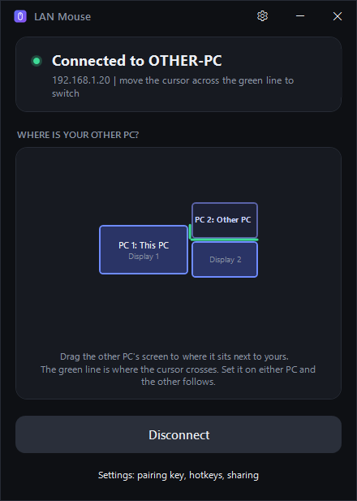

# LAN Mouse

Share one mouse, keyboard and clipboard between two Windows PCs on the same network.

<p align="center"></p>

## Features

- **Screen arrangement:** drag the other PC's screens to where they really sit around yours, with full multi-monitor support. The cursor crosses wherever the screens touch.
- **Hotkeys:** Ctrl+Alt+1 / Ctrl+Alt+2 jump straight to a PC. Scroll Lock brings the cursor home.
- **Smooth handoff:** the pointer is hidden on the PC you're not using, no movement is lost when crossing, and speed is matched between screens with different display scaling.
- **Clipboard on paste:** text, pictures, files and folders. Copying only sends a description; the data moves when you actually paste, over its own connection so it never slows down your mouse and keyboard.
- **Automatic pairing:** type the same pairing key on both PCs and they find each other.
- **Encrypted:** AES-GCM with a key derived from the pairing key.
- **Sign-in screen control (optional):** install a small privileged helper so you can type your PIN/password on the other PC's Windows sign-in screen. Off by default; enable it in Settings. See the security note there.

## Experimental: window sharing (buggy)

Dragging a window across to the other PC (it streams as a live view over UDP, port 47826) is **work in progress and still buggy as hell**. Expect the dragged window to misbehave: contents may not render, the cursor can jump, and dragging/resizing is unreliable. It needs real two-machine testing and more work. Turn it off with the **Drag windows to the other PC** switch in Settings if it gets in the way. Everything else above (mouse, keyboard, clipboard, sign-in) is solid.

## Download

Grab `LanMouse.exe` from the [Releases](../../releases) page and run it on both PCs. It is a single self-contained file, no install or .NET runtime needed.

## Setup

1. Run `LanMouse.exe` on both PCs.
2. Open Settings and enter the same pairing key on both (or generate one and type it on the other PC).
3. Press **Connect** on both.
4. Drag the other PC's screens into place on the map. Set it on either PC and the other follows.
5. If they don't find each other, click **Allow through firewall** on both PCs.

Network ports: UDP 47824 (discovery), TCP 47823 (input), TCP 47825 (clipboard transfers).

## Build from source

Requires the .NET 8 SDK on Windows.

```
dotnet publish -c Release -o release
```

The single-file app ends up in `release\LanMouse.exe`.

## License

MIT. See [LICENSE](LICENSE).
